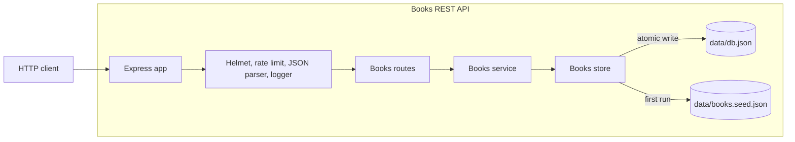

# Books REST API

[](https://github.com/petercordovadev/books-rest-api/actions/workflows/ci.yml)
[](LICENSE)
[](https://nodejs.org/)
[](https://www.typescriptlang.org/)

A small, production-minded REST API for managing a book catalog, built with **Node.js**,
**Express 5** and **TypeScript**.

The project started as a learning exercise based on a REST API tutorial and was later rewritten
with strict typing, request validation, centralized error handling, atomic persistence, tests and
security hardening.

## Features

- Full CRUD for books: list, read, create, replace, patch and delete.
- Runtime validation with **Zod** (strict schemas, no mass assignment).
- Consistent JSON error responses with stable error codes.
- Correct HTTP semantics: `201` + `Location` on create, `204` on delete, `400`/`404` where needed.
- Collision-free numeric IDs, even after deletions.
- Atomic file writes and a mutation queue to avoid corrupted or lost updates.
- Seed data separated from runtime data.
- Security headers with **Helmet**, rate limiting and a 10 kB JSON body limit.
- Request logging with **Morgan**.
- OpenAPI 3 specification and interactive docs at `/docs`.
- 26 automated tests with **Vitest** and **Supertest**.
- Docker image, Compose file and GitHub Actions CI.
- CodeQL and Dependabot configured for supply-chain and static analysis.

## Tech stack

| Area         | Technology                   |
| ------------ | ---------------------------- |
| Runtime      | Node.js 22+                  |
| Language     | TypeScript 5.9 (strict mode) |
| HTTP         | Express 5                    |
| Validation   | Zod 4                        |
| Security     | Helmet, express-rate-limit   |
| Logging      | Morgan                       |
| Tests        | Vitest + Supertest           |
| Quality      | ESLint + Prettier + tsc      |
| Docs         | OpenAPI 3 + Redoc            |
| Distribution | Docker + GitHub Actions      |

## Architecture



The HTTP layer never touches the filesystem. Routes validate and delegate, the service owns the
business rules, and the store is the only module that reads or writes `data/db.json`.

## Project structure

```text
.
├── src/
│   ├── app.ts                    # Express app factory (testable, no port binding)
│   ├── server.ts                 # Process entry point + graceful shutdown
│   ├── config.ts                 # Environment configuration
│   ├── books/
│   │   ├── books.routes.ts       # HTTP routes
│   │   ├── books.schema.ts       # Zod schemas and inferred types
│   │   ├── books.service.ts      # Business rules
│   │   └── books.store.ts        # Atomic JSON persistence
│   ├── lib/
│   │   ├── AppError.ts           # Typed application errors
│   │   └── formatZodIssues.ts    # Validation error formatter
│   └── middleware/
│       ├── errorHandler.ts       # Central error handler
│       ├── notFound.ts           # JSON 404 handler
│       └── validate.ts           # Body validation middleware
├── tests/
│   └── books.test.ts             # Integration tests
├── data/
│   ├── books.seed.json           # Committed seed data
│   └── db.json                   # Runtime data (ignored by git)
├── openapi.yaml                  # OpenAPI 3 specification
├── Dockerfile
├── compose.yaml
└── requests.http                 # Ready-to-run HTTP requests
```

## Getting started

### Requirements

- Node.js 22 or newer
- npm 10 or newer

### Installation

```bash
git clone https://github.com/petercordovadev/books-rest-api.git
cd books-rest-api
npm ci
cp .env.example .env
npm run dev
```

The first run copies `data/books.seed.json` to `data/db.json`. The server starts on
`http://localhost:3000`.

### Production build

```bash
npm run build
npm start
```

### Docker

```bash
docker compose up --build
```

The Compose file mounts a named volume so the JSON database survives container restarts.

## Environment variables

| Variable               | Default                | Description                        |
| ---------------------- | ---------------------- | ---------------------------------- |
| `NODE_ENV`             | `development`          | Runtime environment                |
| `PORT`                 | `3000`                 | HTTP port                          |
| `DB_PATH`              | `data/db.json`         | Runtime database file              |
| `SEED_PATH`            | `data/books.seed.json` | Seed file used on first run        |
| `RATE_LIMIT_WINDOW_MS` | `900000` (15 minutes)  | Rate limit window                  |
| `RATE_LIMIT_MAX`       | `100`                  | Maximum requests per window and IP |
| `TRUST_PROXY`          | `false`                | Trust the first proxy hop          |

Copy `.env.example` to `.env` and adjust the values you need. Never commit `.env`.

## API reference

Base URL: `http://localhost:3000`

| Method   | Path                | Description        | Success |
| -------- | ------------------- | ------------------ | ------- |
| `GET`    | `/health`           | Health check       | `200`   |
| `GET`    | `/`                 | API metadata       | `200`   |
| `GET`    | `/api/v1/books`     | List books         | `200`   |
| `GET`    | `/api/v1/books/:id` | Get one book       | `200`   |
| `POST`   | `/api/v1/books`     | Create a book      | `201`   |
| `PUT`    | `/api/v1/books/:id` | Replace a book     | `200`   |
| `PATCH`  | `/api/v1/books/:id` | Update some fields | `200`   |
| `DELETE` | `/api/v1/books/:id` | Delete a book      | `204`   |

Interactive documentation is available at [`/docs`](http://localhost:3000/docs) and the raw
specification at [`/openapi.yaml`](http://localhost:3000/openapi.yaml).

### Examples

```bash
# List books
curl http://localhost:3000/api/v1/books

# Get one book
curl http://localhost:3000/api/v1/books/1

# Create a book
curl -X POST http://localhost:3000/api/v1/books \
  -H "Content-Type: application/json" \
  -d '{"title":"The Pragmatic Programmer","author":"Andrew Hunt and David Thomas","year":1999}'

# Replace a book
curl -X PUT http://localhost:3000/api/v1/books/1 \
  -H "Content-Type: application/json" \
  -d '{"title":"The Great Gatsby","author":"F. Scott Fitzgerald","year":1925}'

# Update a single field
curl -X PATCH http://localhost:3000/api/v1/books/1 \
  -H "Content-Type: application/json" \
  -d '{"year":1926}'

# Delete a book
curl -X DELETE http://localhost:3000/api/v1/books/5
```

### Error format

Every error is JSON and follows the same shape:

```json
{
  "error": {
    "code": "VALIDATION_ERROR",
    "message": "Request body is invalid",
    "details": [{ "path": "title", "message": "Title is required" }]
  }
}
```

Stable error codes include `VALIDATION_ERROR`, `INVALID_BOOK_ID`, `BOOK_NOT_FOUND`,
`ROUTE_NOT_FOUND`, `INVALID_JSON`, `PAYLOAD_TOO_LARGE`, `RATE_LIMITED` and `INTERNAL_ERROR`.

## Data persistence

- `data/books.seed.json` is committed and represents the initial catalog.
- `data/db.json` is created at runtime and ignored by git.
- Writes go to a temporary file and are atomically renamed, so a crash cannot leave a half-written
  JSON file.
- Mutations are serialized through an in-process queue, preventing lost updates when two requests
  arrive at the same time.
- IDs are generated as `max(id) + 1`, which avoids the classic `length + 1` collision after a
  deletion.

To reset the catalog, stop the server and delete `data/db.json`; the next start recreates it from
the seed file.

For a public deployment with an ephemeral filesystem, mount a persistent volume or move the store
to SQLite/PostgreSQL. The service layer isolates that change.

## Scripts

| Command                 | Description                                   |
| ----------------------- | --------------------------------------------- |
| `npm run dev`           | Start in watch mode with `tsx`                |
| `npm run build`         | Compile TypeScript to `dist/`                 |
| `npm start`             | Run the compiled server                       |
| `npm run typecheck`     | Type-check source and tests                   |
| `npm run lint`          | Run ESLint                                    |
| `npm run lint:fix`      | Run ESLint and apply safe fixes               |
| `npm run format`        | Format with Prettier                          |
| `npm run format:check`  | Check formatting without writing              |
| `npm test`              | Run the test suite                            |
| `npm run test:watch`    | Run tests in watch mode                       |
| `npm run test:coverage` | Run tests with V8 coverage                    |
| `npm run check`         | Typecheck, lint, format check, test and build |

## Testing

```bash
npm test
npm run test:coverage
```

The suite boots the app with a temporary database per test, so tests never touch your local
`data/db.json`. It covers CRUD flows, validation, 404/400 responses, ID collisions, persistence,
malformed JSON, unknown routes, payload limits and the documentation endpoints.

## Security

- `helmet` sets secure HTTP headers and removes `X-Powered-By`.
- `express-rate-limit` limits requests per IP (configurable).
- JSON bodies are capped at 10 kB.
- Zod schemas are strict: unknown fields such as `id` are rejected instead of silently accepted.
- IDs are generated server-side and cannot be overridden by clients.
- Production errors never expose stack traces.
- `.env` and runtime data are ignored by git.
- CI runs lint, typecheck, tests, build and `npm audit`; CodeQL and Dependabot are configured.
- This demo has no authentication by design. If you add users, use Argon2/bcrypt, short-lived
  tokens, HTTPS and per-user authorization.

Found a security issue? Please read [`SECURITY.md`](SECURITY.md) and report it privately.

## Deployment

The API is stateless except for the JSON file, so it can run on any Node.js host.

- **Docker / VPS**: `docker compose up -d --build`.
- **Render, Railway or Fly.io**: build with `npm ci && npm run build`, start with `npm start`, and
  mount a persistent disk for `data/`.
- **Serverless platforms with ephemeral filesystems**: use SQLite on a mounted volume or migrate to
  PostgreSQL before relying on persistence.

Set `NODE_ENV=production` in production so logs and error messages use production settings.

## Roadmap

- [ ] Add authentication and per-user book collections.
- [ ] Add pagination, filtering and sorting.
- [ ] Migrate persistence to SQLite (`better-sqlite3`) or PostgreSQL + Prisma.
- [ ] Generate typed clients from `openapi.yaml`.
- [ ] Add structured logging and metrics.
- [ ] Deploy a live demo with a persistent database.

## Credits

This project began as a learning exercise following a REST API tutorial on YouTube. The current
implementation is a rewrite: TypeScript, layered structure, Zod validation, atomic persistence,
tests, security middleware and documentation were added afterwards.

## License

Released under the [MIT License](LICENSE).

---

## Resumen en español

API REST para gestionar un catálogo de libros, escrita en **TypeScript** con **Express 5**.
Incluye validación con Zod, manejo centralizado de errores, persistencia atómica en JSON,
tests de integración, documentación OpenAPI, Docker y CI. Los datos de ejemplo viven en
`data/books.seed.json`; el archivo de ejecución `data/db.json` se genera solo y no se sube al repo.
Para levantarla: `npm ci`, `cp .env.example .env` y `npm run dev`.
